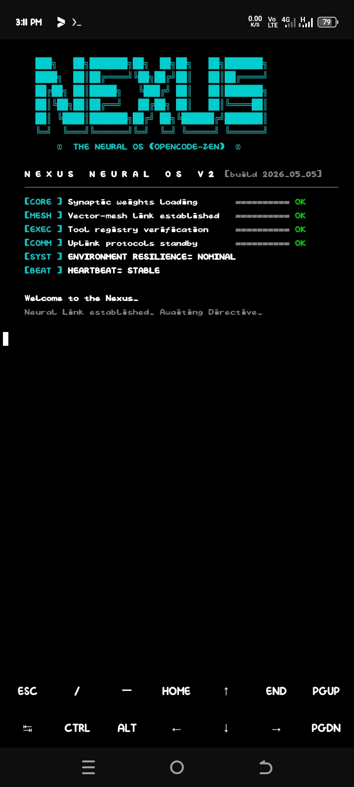
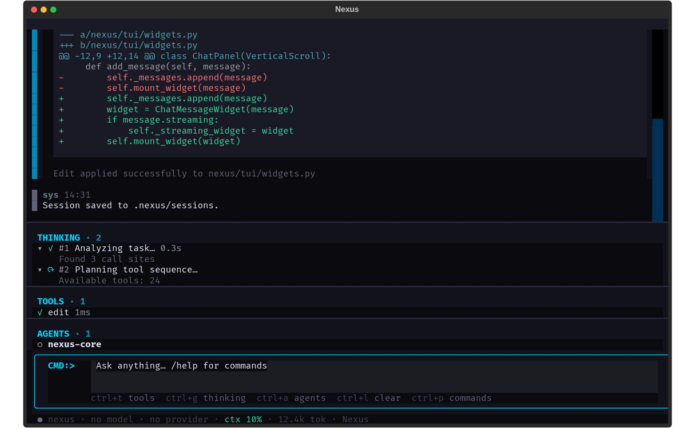
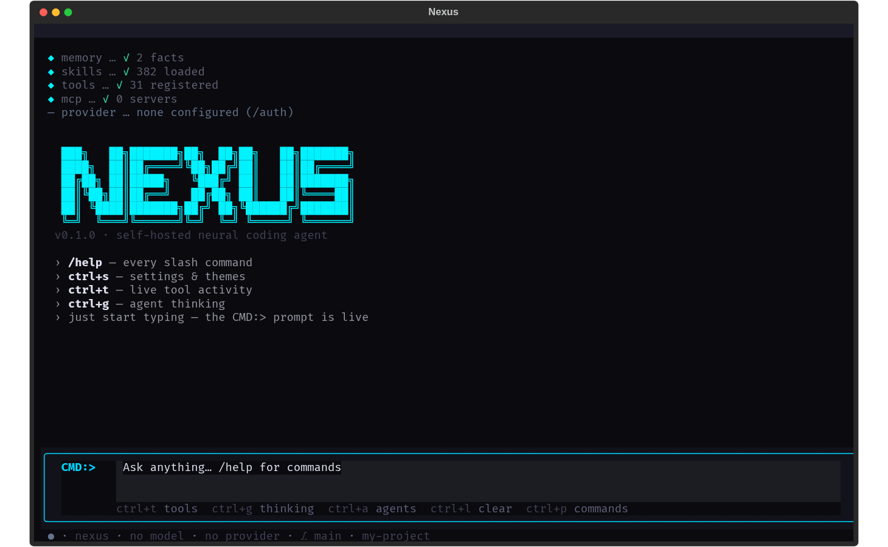
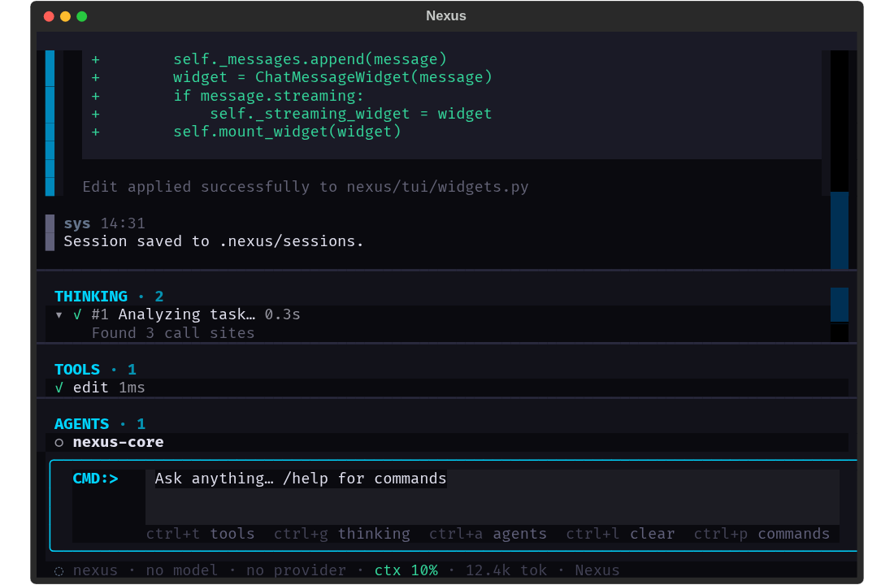

# Nexus — The Neural OS 🌌

<div align="center">



[](LICENSE)
[](https://www.python.org/)
[]()

**Nexus** is a self-hosted, autonomous AI coding agent designed as an AI Operating System for power users. Built for Termux and Linux, it provides a high-fidelity, sci-fi inspired CLI experience with real-time multi-agent orchestration.

[Report Bug](https://github.com/alpha-1-design/Nexus/issues) · [Contributing](./CONTRIBUTING.md)



</div>

---

## 🚀 Key Features

*   **Multi-Agent Governance:** Employs specialized sub-agents (Planner, Coder, Reviewer, Researcher) that collaborate in a shared team chat to solve complex tasks.
*   **True ReAct Loop:** Observe → Think → Act, iterated up to 8 tool rounds with streamed tool-call arguments, valid tool transcripts, and every assistant turn persisted — multi-turn sessions never lose context.
*   **Free Provider Rotation:** 9 providers including Groq, OpenRouter, Cerebras, Gemini, Mistral, GitHub Models, HuggingFace, Cloudflare and Zhipu GLM free tiers. When one rate-limits, Nexus rotates to the next automatically so you keep coding non-stop on free keys.
*   **Global `.env` Credentials:** One file (`~/.nexus/.env`) holds every API key — generated template, `chmod 600`, env-sourced keys never leak into config files.
*   **`/init` Project Context:** One command scans your project (git, languages, manifests, build commands) and generates a `NEXUS.md` context file injected into every turn — like Claude Code's `/init`, works with zero LLM configured.
*   **Neural OS Core:** Built on a "Governor" pattern that manages the lifecycle of memory, tools, and orchestration subsystems.
*   **Real Memory Layer:** Facts, session history, and recall are consulted on every turn — not just stored.
*   **382 Bundled Skills + 92-Server MCP Marketplace:** `nexus skill search`, `nexus mcp catalog/search/install` — a curated library ported from the community, available offline out of the box.
*   **Atmospheric TUI:** Claude Code-class transcript with timestamps, collapsible tool-call cards, live unified-diff rendering for every edit, streaming responses with a blinking cursor, and live Thinking/Tools/Agents panels.
*   **GIA Web Dashboard:** A dark, ChatGPT/LibreChat-style chat interface in the browser, with real token streaming, wired to the same agent core as the CLI.
*   **Offline-First & Local:** Designed for Termux/Mobile, Nexus is optimized for low-bandwidth, high-latency environments.

---

## 🏗️ Architecture

Nexus operates on a multi-layer Neural OS architecture:
1.  **Orchestrator:** The primary agent lead that delegates tasks based on task complexity, with memory recall/persistence wired into every turn.
2.  **Vector-Mesh Memory:** A persistent SQLite-backed memory store providing long-term project context.
3.  **Resilience Layer:** A circuit-breaker and doctor module that monitors sub-agent health in real-time.
4.  **Plugin System:** A drop-in architecture for extending core OS capabilities.
5.  **GIA Dashboard:** A Flask-based web layer exposing the same agent core over HTTP/SSE, for a browser-based chat experience.

---

## 🛠️ Quick Start

```bash
git clone https://github.com/alpha-1-design/Nexus.git
cd Nexus

# One command — auto-detects Android/Termux vs Linux/macOS.
# Installs into an isolated venv under ~/.nexus with tui + dashboard.
bash install.sh
```

**Laptop options**
```bash
bash install.sh --with-browser   # add Playwright + Chromium (browser automation)
bash install.sh --dev            # add dev/test extras (pytest, ruff, mypy)
bash install.sh --uninstall      # remove venv + command + PATH lines (keeps your data)
```

> **Termux:** the dispatcher routes to `install-termux.sh`, which installs the
> tested Android target (`tui` + `dashboard`, pure Python + `psutil`). Voice
> extras remain a stub, and Playwright is not usable on stock Termux — Nexus
> degrades gracefully without both.

**Connect a provider — free keys recommended:**
```bash
nexus auth       # wizard: pick "Auto (free rotation)", paste 1+ free keys
```
Free keys come from Groq, OpenRouter, Cerebras, Google AI Studio and more —
the wizard shows the signup URL for each. Keys live in `~/.nexus/.env`
(a commented template is generated for you). With rotation on, a rate-limited
provider hands off to the next one automatically.

**Start the agent:**
```bash
nexus tui        # full Textual terminal UI (screenshots above)
nexus repl       # classic text REPL
nexus dashboard  # GIA web dashboard
```

**In any project:**
```bash
/init            # scan the project, generate NEXUS.md context (in TUI/REPL)
nexus init       # same, from the shell
```

**First run:** if no LLM provider is configured yet, Nexus walks you through
an interactive setup the first time you run a command that needs one.
Utility commands like `nexus mcp catalog`, `nexus skill search`, and
`nexus doctor` work immediately without any provider configured.

**Verify the install worked:**
```bash
nexus doctor       # full diagnostic report — dependencies, config, provider, git
nexus mcp catalog  # browse the bundled 92-server MCP marketplace
nexus skill search python   # search the bundled skill library
```

## 📸 Screenshots

| Boot | Termux (90×30) |
|---|---|
|  |  |

---

## 📜 Contributing & Community

We are building a decentralized ecosystem of intelligent tools. Whether you are building plugins or hardening the OS core, check out our [Contributing Guide](./CONTRIBUTING.md).

Distributed under the **MIT License**. Built for the Alpha-1 Ecosystem.
